


I build **real-time systems, AI agents and full-stack products** for enterprise clients — 
taking an idea from **architecture → implementation → interface → deployment**.

<a href="https://muizkmz.vercel.app/"></a>






<a href="https://muizkmz.vercel.app/#project"></a>


<picture>
  <source media="(prefers-color-scheme: dark)"  srcset="https://raw.githubusercontent.com/MuizKmz/MuizKmz/output/snake-dark.svg">
  <source media="(prefers-color-scheme: light)" srcset="https://raw.githubusercontent.com/MuizKmz/MuizKmz/output/snake.svg">
  
</picture>



<a href="https://muizkmz.vercel.app/">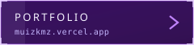</a>  <a href="https://linkedin.com/in/muizzuddin-kamarozamaan">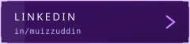</a> 


